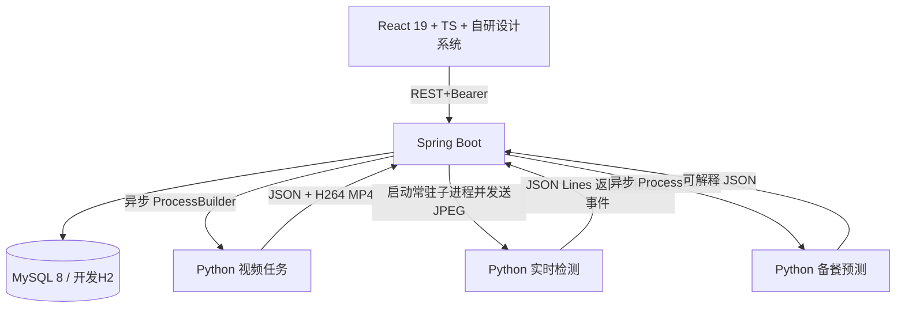

# 灶眼 AI V1.0 架构与业务设计

## 功能范围

1. 经营驾驶舱：按 `origin` 数据域查询当日有效初判出餐、待复核、已确认及手工备餐数量；最近 7 日和时段图表。
2. AI 出餐监测：上传视频（200 MB 限制）；Spring Boot 创建异步任务；Java `ProcessBuilder` 以独立进程启动 `python -m zaoyan_ai.video_job`；Python 输出 JSON 和可播放视频；Java 最终入库。
3. 实时摄像头：浏览器经授权采集 JPEG 帧，每约 850ms 上传一次；Spring Boot 对每个会话保有一个**常驻 Python 子进程**，通过 stdin/stdout JSON Lines 调用，而不是每帧重新加载模型。
4. 事件管理：AI 初判 `PENDING`，操作员确认 `CONFIRMED` 或剔除 `REJECTED`，人工补录始终为 `CONFIRMED`，审核审计永久记录。
5. 备餐管理：计划备餐、实际备餐和人工核实出餐分别录入，不能用计划量伪装实际销量。
6. 备餐预测：Java 异步启动 `python -m zaoyan_ai.forecast`，要求至少三天同餐次有效的人工填报出餐历史；加权均值计算预测需求及安全缓冲。
7. 报表：按北京时区生成日报，CSV 导出，模拟数据与真实数据隔离。
8. 系统设置：第一版单档口，归一化计数线两端点及正反方向；系统管理员才能修改。

## 数据流

## 视觉算法分层

`ai-engine/zaoyan_ai/vision.py` 是对外门面，只负责保持稳定的公开 API
（`Detection` / `CentroidTracker` / `Detector` / `LineCounter` /
`select_targets` / `draw_annotations`）。真正的实现按职责拆分为：

| 模块 | 职责 | 关键设计 |
| --- | --- | --- |
| `segmenter.py` | 自适应色块分割与候选几何过滤 | 用带界约束的统计替代写死的 HSV 区间：种子区间是安全网，前若干帧据实收紧密度边界后冻结，避免逐帧漂移导致检测闪烁。开/闭运算核随分辨率缩放；距离变换 + 分水岭拆分粘连目标；填充率、凸度、长宽比、边缘截断共同决定置信度 |
| `tracker.py` | 多目标跟踪 | 每条轨迹一个匀速 Kalman 滤波器（状态 `[cx,cy,w,h,vx,vy,vw,vh]`），关联代价 `1 - IoU`，Hungarian 求全局最优指派，中心距门限按画面高度归一化。自带 Hungarian 实现，不引入 SciPy |
| `linecross.py` | 越线状态机 | 有向线段符号距离 + 段内投影 + 线性插值求交点；速度外推用于遮挡期；诊断标记按单次越线作用域收集，不再永久累积污染 `riskReasons` |
| `annotate.py` | 标注渲染 | Pillow + 系统 TrueType 字体渲染中文（OpenCV 的 Hershey 字体无法绘制 CJK）；ROI 外置黑而非整片涂黑；HUD 与图例按画面尺寸等比缩放 |

**为什么不再是硬编码 HSV**：原实现的 `[75,80,55]-[105,255,255]` 对灯光、
白平衡和餐盒色号的变化毫无余地，一次现场换灯就整体漏检。自适应版本在
保持同一条青绿色验证基线的前提下，把阈值从常量变成由数据估计的区间。

**这仍然是经典视觉基线**，不代表真实食堂场景的检测精度；真实识别需要
自训 YOLO 权重并另行做场景验证。

## 数据库表

| 表 | 主要内容 | 关键约束 |
| --- | --- | --- |
| `stalls` | 名称、位置、归一化计数线与方向 | 单档口初始配置 |
| `video_tasks` | 视频路径（后端私有）、进度、状态、算法、数据域、处理结果 | UUID 任务号；生成后异步执行 |
| `count_events` | `taskId`、`trackId`、事件时间、置信度、初判/复核状态与数据域 | 机器事件的 `taskId + trackId` 入库幂等检查 |
| `review_audits` | 操作人、状态变化、时间、备注 | 不删除历史审计 |
| `prep_records` | 日期、餐次、计划、实际备餐、人工核实出餐 | `stallId, origin, serviceDate, mealSlot` 唯一 |
| `forecast_runs` | 预测任务状态、样本数、预测量、建议量、解释与错误 | 数据不足返回 INSUFFICIENT |

- `SIMULATION` 与 `REAL` 作为所有业务实体的数据域，读取 API 显式传入，不允许在汇总中自动合并。
- `reviewStatus=PENDING/CONFIRMED` 都属于当前未被剔除的**初步有效事件**；这不意味着检测准确率已人工认证。`REJECTED` 不进入有效统计。
- 实时摄像头默认仅保留结构化事件，不保存原始帧；上传视频仍保留原始文件和标注视频，需要后续制定删除周期与权限细则。
- JWT 未使用：第一版使用后端内存中带过期时间的随机 Bearer Token；服务重启全部失效，适合封闭环境原型。面向公网商用需接正式身份系统、登录限流、审计和 HTTPS。
- HTTP 任务响应非阻塞；视频处理超时 300 秒可配置。当前直播帧请求串行处理，限制最多 2 个会话，服务端 90 秒空闲清理。

## 主要 REST API

| 动词与路径 | 功能 |
| --- | --- |
| `POST /api/auth/login` | 返回短期 Bearer Token |
| `GET /api/auth/me` | 当前登录用户 |
| `POST /api/auth/logout` | 撤销当前令牌 |
| `GET /api/stalls` | 读取档口配置 |
| `PUT /api/stalls/{id}` | 管理员编辑档口与计数线 |
| `POST /api/tasks/upload` | 上传视频并创建异步任务；multipart `file`, `origin`, `detector`, `stallId` |
| `GET /api/tasks` | 最近 30 个任务（需认证） |
| `GET /api/tasks/{id}` | 单任务状态及进度 |
| `GET /api/tasks/{id}/events` | 该任务生成的自动事件 |
| `GET /api/tasks/{id}/video` | 认证后下载标注视频 |
| `POST /api/live/start` | 创建常驻 Python 实时分析会话 |
| `POST /api/live/{id}/frame` | multipart `frame` 发送 JPEG 并接收检测框/事件 |
| `POST /api/live/{id}/stop` | 关闭实时会话及 Python 进程 |
| `GET /api/events?origin=` | 查看出餐事件 |
| `PATCH /api/events/{id}/review` | 人工确认或剔除 |
| `POST /api/events/manual` | 人工补录有效出餐 |
| `GET /api/audits` | 查看复核审计 |
| `GET /api/prep?origin=` | 备餐记录列表 |
| `POST /api/prep` | 同日期餐次幂等保存备餐记录 |
| `POST /api/forecasts` | 异步预测（`stallId,origin,mealSlot,bufferRate`） |
| `GET /api/forecasts/{id}` | 查询预测结果或数据不足原因 |
| `GET /api/dashboard?origin=` | 今日与趋势汇总 |
| `GET /api/reports/daily?origin=&date=` | 日报结构化数据 |
| `GET /api/reports/export.csv?origin=&date=` | 导出 Excel 可打开的 UTF-8 CSV |

## 前端页面

- `/login`：自有品牌视觉、登录和错误提示。
- `/dashboard`：经营驾驶舱、趋势、时段分布、三步引导、近期事件。
- `/monitor`：视频/实时摄像头切换、算法模式、处理进度、标注视频、任务历史。
- `/events`：筛选、查看、人工确认/剔除、手工补录、审计明细。
- `/planning`：备餐录入、可解释预测、安全缓冲设置、历史记录、可选模拟样本填充。
- `/reports`：日期筛选、日报统计、备餐明细、CSV 导出。
- `/settings`：名称、位置、计数线位置和方向、隐私策略。

## 前端样式架构

样式按职责分层，全部为手写语义类：

| 文件 | 内容 |
| --- | --- |
| `styles/tokens.css` | 设计令牌：中性偏冷色阶、品牌绿、语义色、字阶、4px 间距栅格、圆角、阴影、动效时长 |
| `styles/base.css` | 自足重置 + 跨页面原语（按钮、卡片、表单、徽标、表格、弹层、骨架屏） |
| `styles/shell.css` | 应用外壳：侧栏、顶栏、数据域横幅、内容区、页脚、响应式断点 |
| `styles/pages-core.css` | 经营驾驶舱、AI 出餐监测 |
| `styles/pages-forms.css` | 事件复核、智能备餐、数据报表、系统设置 |
| `styles/pages-misc.css` | 登录页、通知中心外观 |

三个刻意的取舍：

1. **不再依赖 Tailwind / PostCSS。** 原项目所有样式都是手写语义类，Tailwind
   仅承担重置职责；而且 postcss 会在被 Vite 监视的 `src` 目录内创建临时文件，
   实测触发过 `EBUSY: resource busy or locked` 让整个 fs watcher 崩溃。
2. **移除 Google Fonts 的 `@import`。** 那是渲染阻塞的外部请求，在离线或受限
   网络下会拖住首屏；改用系统 CJK 字体栈（PingFang / 微软雅黑 / HarmonyOS Sans）。
3. **最小字号 12px。** 原实现大量使用 9–11px，中文在该尺寸下可读性很差。

实时摄像头逻辑从页面抽到 `lib/useLiveCamera.ts`：会话代次票据、
帧上传闸门、ROI 遮罩与画布叠绘原本和渲染交织在一个组件里，
抽出后各自可独立推理与测试。

## 尚未实现或需要后续加强

- 没有真实食堂授权数据，也未训练真实餐盒模型；不可宣传具备真实生产场景准确率。
- 直播为低采样帧率的 MVP 实时方案，不是 25FPS RTSP 高并发推流；目前不支持多摄像头统一中心管理。
- 默认 H2/JPA auto-update 方便本地启动；正式 MySQL 项目演进需增加 Flyway 版本迁移及完整数据库备份。
- 视频文件未实施自动过期删除、数据加密及完整租户级权限；不应直接上线存储个人影像的真实商业生产环境。
- Java 后端与 React 构建需要开发者安装 Maven/npm 包后运行测试；算法单元测试已在当前环境执行。
